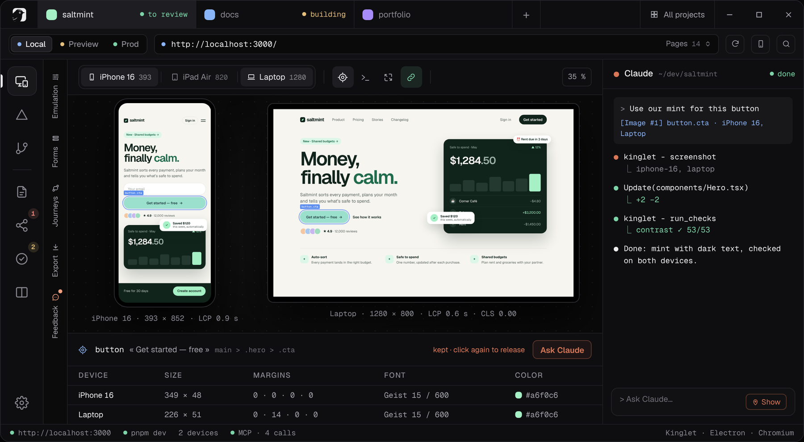
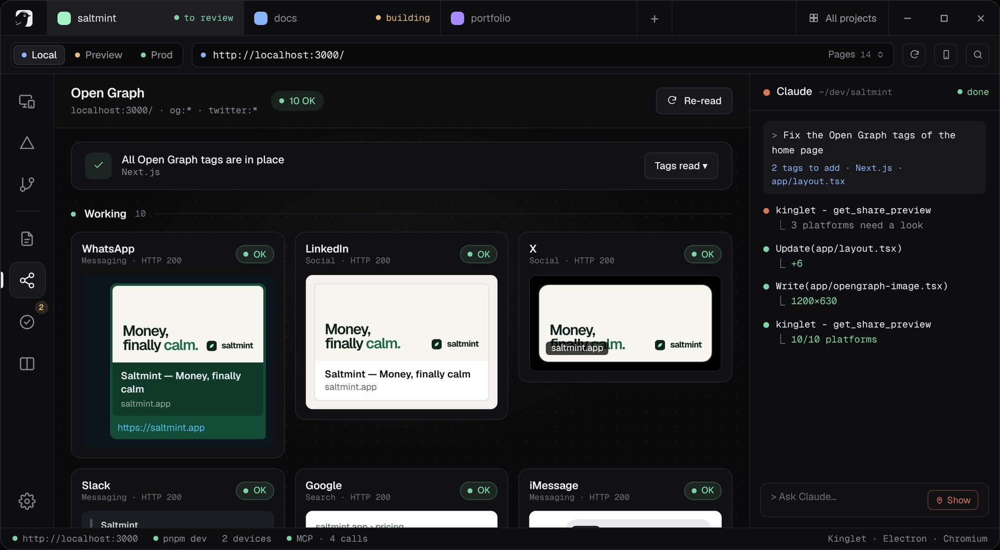
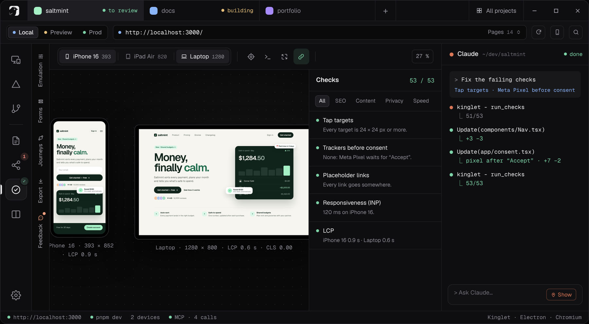

<p align="center">
  <a href="https://getkinglet.com">
    <picture>
      <source media="(prefers-color-scheme: dark)" srcset="brand/kinglet-logo-white.svg">
      
    </picture>
  </a>
</p>

<p align="center">
  <strong>The dev environment for vibe coding.</strong><br>
  Build with Claude, see your site on 10 devices at once, point at what’s wrong and let Claude fix it.
</p>

<p align="center">
  <a href="https://github.com/stevenpersia/kinglet/releases/latest"></a>
  
  
  <a href="https://getkinglet.com"></a>
</p>

<p align="center">
  
</p>

## What it does

- **Every device at once.** 10 emulated devices (iPhone, Android, iPad, laptop…), scroll and navigation in sync, and your real phone over Wi-Fi.
- **Point, Claude fixes.** Inspect any element, send it (or console errors) to Claude Code, which runs right inside Kinglet.
- **53 checks.** SEO, content, mobile, accessibility, privacy, performance and security, on every render.
- **Open Graph previews.** How your link looks on WhatsApp, LinkedIn, X, Slack, Google and 5 more, read by their own bots.
- **Local, preview, prod.** Vercel and GitHub built in: previews, pull requests, CI, deploy history.
- **MCP server.** Claude Code can open pages, take screenshots and run the checks itself.

<table>
  <tr>
    <td></td>
    <td></td>
  </tr>
  <tr>
    <td align="center">Open Graph on 10 platforms</td>
    <td align="center">53 checks, fixed by Claude</td>
  </tr>
</table>

## Download

Kinglet is **free**: no account, no license key. Linux for now.

Grab the [latest release](https://github.com/stevenpersia/kinglet/releases/latest), then:

```bash
chmod +x Kinglet-*.AppImage && ./Kinglet-*.AppImage   # any distribution
```

```bash
sudo pacman -U Kinglet-*.pacman                         # Arch, CachyOS
```

Kinglet updates itself. To let Claude Code use it from your terminal:

```bash
claude mcp add --scope user kinglet -- kinglet --mcp --ozone-platform=headless
```

## Develop

```bash
pnpm install && pnpm dev
```

```bash
pnpm test                          # unit tests
```

```bash
pnpm --filter @kinglet/web dev     # the website, getkinglet.com
```

To publish a version, bump `apps/desktop/package.json` and run **Actions → Release**: it tests, builds and publishes the AppImage and pacman package here.

<p align="center"><sub>Made for sites built with Claude · <a href="https://getkinglet.com">getkinglet.com</a></sub></p>
